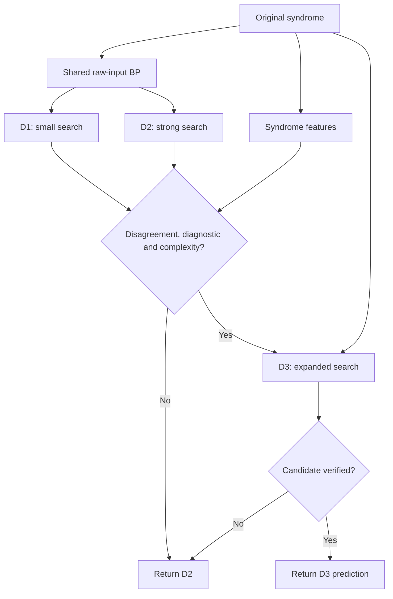

# Hierarchical trust decoder with raw syndrome passthrough

This is a separate implementation of the Team Lead's hierarchy. The earlier partial-correction submission remains separate. This architecture does not apply D1's corrections before D2 or D3.

## Architecture

1. Shared feature extraction describes the original 70-bit detector pattern: weight, connectivity among fired detectors, fired-edge density, and time span. Adjacency means two detectors share an error mechanism in the supplied circuit model. No surface-code boundary features are assumed.
2. D1 is our own short BP decoder with a small ordered-statistics search (8 BP iterations maximum, 32 single free-variable changes, pairs among the first 8).
3. D2 is our own stronger BP decoder with a larger search (60 BP iterations maximum, 256 singles, pairs among the first 64).
4. The router compares the actual four logical predictions. Agreement returns D2. Disagreement reaches D3 only if D2 has a diagnostic flag and the raw pattern passes the calibrated structural gate.
5. D3 expands the search to 2,048 singles and pairs among the first 256 free variables. It uses the original syndrome and original mechanism probabilities. D2's BP state and nested candidate pool are reused. Valid reference corrections can contribute a strictly better candidate without imposing their bits as constraints or double-counting an already enumerated candidate.
6. A verified D3 candidate permits D3's bitwise marginal prediction. Failed D3 verification returns D2; unrouted shots return D2. Invalid D2 candidates cause a hard error rather than an unverified submission.

Both D1 and D2 return a valid reference correction plus predictions obtained from candidate-weighted logical bit marginals. Agreement is on the scored logical predictions. A marginal prediction need not equal a single reference correction's complete logical vector.

The frozen routing rule in `gate.json` is:

- D1 and D2 disagree on at least one logical bit; AND
- D2 BP failed to converge OR its minimum logical bit confidence proxy is below 0.05; AND
- raw syndrome weight is at least 4 OR its largest fired-detector component has at least 4 vertices.

With both selected structural thresholds equal to 4, the weight condition already covers the component condition. Connectivity, density, and time span remain available diagnostics; this first gate does not demonstrate additional predictive value from those richer features.

The confidence proxy is computed from the restricted candidate pool. It is not a calibrated guarantee of correctness. BP nonconvergence and candidate ambiguity are diagnostics, not a definitive diagnosis of quantum degeneracy.

D3 is an approximate broader candidate-search specialist. This build does not implement ILP, a tensor network, or a transformer and does not claim exact maximum-likelihood decoding or state-of-the-art performance.

## Multithreading

Numba's `prange` runs independent shots on native CPU worker threads. No nested D1/D2 thread pools are created. D1 and D2 share the same raw-input BP prefix; D1's answer never changes D2's syndrome or priors. Exact equivalence with independent BP calls is tested.

Use `NUMBA_NUM_THREADS` to select the worker count. Local checks used 8 threads on a machine with 9 visible CPU cores. The organiser's documented timing allowance is 48 CPU threads. We do not assume that hundreds of software threads correspond to available cores or improve performance.

The warmed local benchmark over the same 512 shots measured median times of 4.307 s on one thread and 0.952 s on eight, a 4.52x speedup. Predictions and diagnostics matched exactly across thread counts. This is an offline batch-throughput measurement, not a microsecond per-shot latency claim or a measurement on the organiser's hardware.

D2 still runs on every shot. Routing saves work relative to running D3 on all shots; it does not eliminate D2's cost.

## Calibration and held-out evaluation

Routing thresholds and D3 search size were selected on 6,000 simulated tuning shots. The gate was frozen before evaluating a new 20,000-shot sample with seeds `710123 + ord(basis)`.

| Method | X LER | Z LER | Overall LER |
|---|---:|---:|---:|
| D2 alone | 3.8875% | 4.0100% | 3.94875% |
| Hierarchical decoder | 3.7025% | 3.8425% | 3.77250% |

D3 was invoked on 4.85% of held-out shots. It corrected 291 previously wrong bits and introduced 150 new wrong bits, a net gain of 141 bits. Its improvement over D2 is 0.17625 percentage points, with an approximate paired 95% interval of 0.10618 to 0.24632 points. This is about 4.46% fewer incorrect bits relative to D2, not a 4.46-point improvement.

The new sample differs from earlier validation sets; compare methods within this table. This is not a Kaggle score.

The gate leaves shared failures untouched: 2,193 wrong D2 bits occurred on D1/D2 agreement shots. Agreement and syndrome verification cannot prove logical correctness. D3 can make valid but wrong predictions, as the introduced-error count demonstrates. No fault-tolerance guarantee is claimed.

## Reproduce

```bash
python -m venv .venv
.venv/bin/python -m pip install -r requirements.txt
NUMBA_NUM_THREADS=8 OPENBLAS_NUM_THREADS=1 .venv/bin/python checks.py
NUMBA_NUM_THREADS=8 OPENBLAS_NUM_THREADS=1 .venv/bin/python benchmark_threads.py
NUMBA_NUM_THREADS=8 OPENBLAS_NUM_THREADS=1 .venv/bin/python make_submission.py --test /path/to/test.csv --output submission_hierarchical.csv
NUMBA_NUM_THREADS=8 OPENBLAS_NUM_THREADS=1 .venv/bin/python verify_csv.py --test /path/to/test.csv --submission submission_hierarchical.csv
```

`decoder.py` defines the required `decode(circuit, detector_events)`. Include `kernels.py`, `circuit_model.py`, `gate.json`, and pinned requirements in code hand-in. `decode` does not read test CSVs, labels, fixtures, or stored predictions. No pretrained decoder or ready-made QEC decoder library is used. Compilation happens at import, outside the timed calls.

`calibrate.py` and `explore.py` reproduce tuning using the supplied calibration fixtures. They overwrite `gate.json`; preserve the selected configuration if reproducing the delivered CSV. `validate.py` samples fresh held-out data and reproduces the paired comparison. `check_handin.py` measures two full 100,000-shot decode calls.

The available test environment is Python 3.12. Python 3.13 and the organiser's NVIDIA B200/48-core environment remain untested. See BUILD_REPORT.md for generation and reproduction checks. The original circuit files' license is retained in UPSTREAM_LICENSE.

## Decision flow


